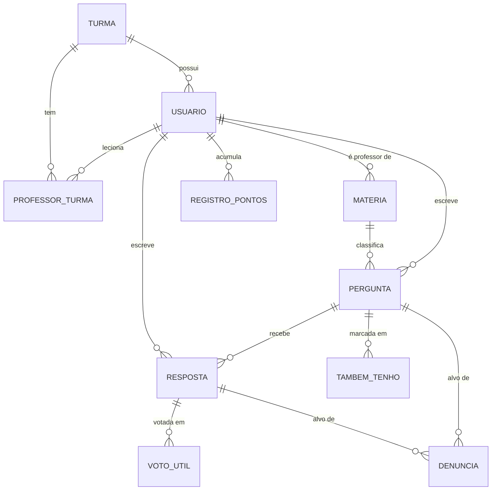

# Ágora — Fórum Escolar

Repositório de Back-end + Web do projeto **Ágora**, que busca responder à pergunta: *seria possível instigar a participação de monitores escolares durante a educação básica, através da credenciação de instituições em um fórum educacional de perguntas e respostas?*

O sistema permite que **alunos publiquem dúvidas organizadas por matéria, recebam respostas validadas por professores/monitores e acompanhem um termômetro de dúvidas da turma**, além de disponibilizar um painel restrito ao professor para validar respostas, moderar conteúdo denunciado, gerenciar monitores e gerar o código da turma.

Projeto desenvolvido por uma equipe do **MedioTEC SENAC/RN (Mossoró)**, com foco na utilização por instituições da **Fecomércio**.

## Identidade Visual

| Cor | Hex |
| :--- | :--- |
| Rosa principal | `#D30C7B` |
| Rosa claro (fundo) | `#FFE3DC` |
| Rosé | `#DBB4AD` |
| Verde acinzentado | `#A2AD91` |
| Marrom escuro (texto) | `#3A2D32` |

Protótipo: [Figma](https://www.figma.com/design/Fpcmvtdtn7pa6DSt5E4y9H/Projeto-integrador?node-id=0-1&t=NFpNgg9ci7902mog-1)

## Stack Utilizada
### Back-End
- **Node.js + TypeScript** — Runtime e linguagem base.
- **Express 5** — Framework web para rotas e middlewares.
- **OOP** — Classes com atributos privados, getters/setters, `validar()` e `fromJSON()` / `toJSON()`.
- **Repository Pattern** — Camada de persistência desacoplada sobre banco relacional.
- **MySQL (`mysql2`)** — Banco de dados, com migrations e seeds versionadas.
- **Autenticação & Segurança** — `bcrypt` para hash de senhas e **JWT** (`jsonwebtoken`) para autenticação *stateless*.
- **Upload de Arquivos** — `Multer` para anexos de perguntas (1 arquivo, imagem ou PDF, até 5 MB).
- **Testes** — `Jest`, `ts-jest` e `Supertest`.
- **Qualidade** — ESLint, Prettier, Husky (lint no pre-commit) e lint-staged.

### Front-end
- **EJS** — Templates HTML renderizados no servidor.
- **CSS3 customizado** — Paleta própria, mobile-first (a partir de 360px).
- **JavaScript Vanilla (`public/js/`)** — `fetch API` para busca com debounce, sugestão de perguntas parecidas, "também tenho essa dúvida" e validação de resposta, com estados de *loading*.

## Equipe e Papéis

| Integrante | Papel Principal | Responsabilidades |
| :--- | :--- | :--- |
| **Fábio Guilherme** | Líder Técnico, QA, Documentação | Equipe e responsabilidades, regras de negócio, Git/controle de versão |
| **Adônis Bezerra** | Front-End, QA, Apresentador | Front-end / UX |
| **João Felipe** | Front-End, QA, Testes | Testes, critérios de avaliação/aceite, segurança e autenticação |
| **Oséias Costa** | Back-End, QA, Apresentador | Requisitos e funcionalidades, arquitetura técnica |
| **Alice Gurgel** | Web-Designer, Front-End | Front-end / UX, identidade visual |
| **João Victor** | Front-End, Apresentador | Requisitos, regras de negócio, Git/controle de versão, entregáveis finais |

**Regras de participação**
- Apresentações são feitas apenas pelas pessoas designadas.
- Mínimo de **75** commits por participante.
- Alterações de código apenas na própria área de domínio; se alguém alterar área alheia, o dono da área deve ser convocado para revisar.
- Commits seguem o padrão `feat`, `fix`, `docs`, `chore`, `refactor`, `test`, `build`, `ci`, `perf`.

## Perfis e Regras de Negócio (resumo)

| Perfil | O que pode fazer |
| :--- | :--- |
| **Aluno** | Perguntar, responder, votar "útil", marcar "também tenho essa dúvida", denunciar, resolver a própria pergunta |
| **Monitor** | Tudo do aluno + validar respostas |
| **Professor** | Perfil de maior permissão (equivale ao administrador). Tudo do monitor + retirar validação, moderar denúncias, promover/rebaixar monitor, gerar código da turma, ver indicadores |

Regras principais (RN-01 a RN-37):
- Só usuários autenticados acessam o fórum; o aluno só vê a própria turma (RN-01, RN-02).
- Cadastro exige código de turma válido e senha com mínimo de 8 caracteres; após 5 logins errados, bloqueio de 10 min (RN-06, RN-07, RN-09).
- Pergunta: título 10–120 caracteres, descrição mínimo 20, limite de 5 perguntas por dia (RN-21, RN-24).
- Cada pergunta tem no máximo 1 resposta validada; só Professor/Monitor valida (RN-17).
- "Também tenho essa dúvida" e voto "útil": 1 por usuário; o autor não pode marcar/votar (RN-15, RN-16).
- 3 denúncias ocultam o conteúdo até revisão do professor (RN-05).
- Termômetro (últimos 7 dias): Frio 0–4, Morno 5–14, Quente 15+ (RN-26, RN-27).
- Pontuação: resposta +1, voto útil +2, resposta validada +10, sem pontos negativos (RN-35).

## Modelo de Dados



Restrições `UNIQUE`: `TambemTenho(usuario_id, pergunta_id)` e `VotoUtil(usuario_id, resposta_id)`.

## Estrutura de Pastas
```
Agora-ForumEscolar/
├── src/
│   ├── database/
│   │   ├── config/conexao-database.ts   # Pool de conexão MySQL
│   │   ├── migrations/                  # 001 a 010 (usuarios ... registropontos)
│   │   ├── seeds/                       # usuários, turmas/matérias, perguntas/respostas
│   │   ├── run-migrations.ts
│   │   ├── run-seeds.ts
│   │   └── test-db.ts
│   ├── entities/        # Classes OOP (Usuario, Turma, Materia, Pergunta, Resposta, ...)
│   ├── models/          # Repositories           [A IMPLEMENTAR]
│   ├── services/        # Regras de negócio      [A IMPLEMENTAR]
│   ├── routes/          # Rotas do MVP, container (injeção) e apresentadores (back → views)
│   ├── middlewares/     # auth, role, upload     [A IMPLEMENTAR]
│   ├── views/           # Templates EJS          [A IMPLEMENTAR]
│   ├── app.ts
│   └── server.ts
├── public/              # css, js, uploads       [A IMPLEMENTAR]
├── .env.example
├── tsconfig.json
├── package.json
└── README.md
```

## Arquitetura e Diagramas UML
Arquitetura em camadas inspirada em MVC:
- **Entities** — domínio, atributos privados, validações e `fromJSON()` / `toJSON()`.
- **Models / Repositories** — Repository Pattern sobre MySQL.
- **Services** — regras de negócio puras (perguntas parecidas, validação única, termômetro, pontuação, moderação, indicadores).
- **Routes / Controllers** — entrada HTTP.
- **Middlewares** — verificação de JWT, autorização por perfil (Aluno / Monitor / Professor) e upload.
- **Views** — EJS no servidor.

### Casos de Uso
Atores: Aluno, Monitor, Professor e Tempo (timer).

| ID | Caso de uso | Ator |
| :--- | :--- | :--- |
| UC-01 | Cadastrar-se | Aluno |
| UC-02 | Autenticar-se | Todos |
| UC-03 | Publicar pergunta | Todos |
| UC-04 | Buscar / filtrar perguntas | Todos |
| UC-05 | Marcar "Também tenho essa dúvida" | Todos (exceto autor) |
| UC-06 | Responder pergunta | Todos |
| UC-07 | Votar "útil" | Todos (exceto autor) |
| UC-08 | Marcar pergunta como resolvida | Autor |
| UC-09 | Denunciar conteúdo | Todos |
| UC-10 | Consultar termômetro de dúvidas | Todos |
| UC-11 | Editar perfil | Todos |
| UC-12 | Ver perfil público de colega | Todos |
| UC-13 | Validar resposta | Professor, Monitor |
| UC-14 | Retirar validação | Professor |
| UC-15 | Moderar conteúdo denunciado | Professor |
| UC-16 | Consultar fila de validação | Professor, Monitor |
| UC-17 | Promover / rebaixar Monitor | Professor |
| UC-18 | Gerar código da turma | Professor |
| UC-19 | Consultar indicadores | Professor |

Relações: UC-13 *include* UC-16; UC-09 *extend* UC-15 (a partir da 3ª denúncia).

### Diagramas
[PENDENTE: diagrama de casos de uso visual, de classes e de sequência ainda não produzidos.]

## Tabela de Rotas da API
Autenticação: JWT em cookie `token` (httpOnly, SameSite=Lax, 8 h) ou `Authorization: Bearer <token>`. Rotas protegidas passam por `authGuard` + `carregarUsuario` (o perfil vem sempre do banco). Quem usa `fetch` envia `Accept: application/json` e recebe JSON; navegação comum recebe HTML (EJS) ou redirect. Erros: 400 validação, 401 não autenticado, 403 sem permissão, 404 não encontrado, 409 regra de negócio, 429 login bloqueado.

| Método | URL | Descrição | Acesso | Resposta |
| :--- | :--- | :--- | :--- | :--- |
| GET | `/` | Landing (logado vai para `/perguntas`) | Público | HTML |
| GET | `/login` | Tela de login | Público | HTML |
| POST | `/login` | Autentica (`email`, `senha`), grava o cookie | Público | 302 `/perguntas`; 401 ou 429 com a tela e a mensagem |
| GET | `/cadastro` | Tela de cadastro | Público | HTML |
| POST | `/cadastro` | Cria aluno e autentica (`nome`, `email`, `senha` mín. 8, `codigoTurma`) | Público | 302 `/perguntas`; 400 ou 409 com erros por campo |
| POST | `/logout` | Descarta o cookie | Público | 302 `/` |
| GET | `/perguntas` | Feed; filtros `q`, `materia`, `status` (aberta, respondida, validada), `minhas=1` | Logado | HTML |
| GET | `/perguntas/nova` | Formulário de nova pergunta | Logado | HTML |
| GET | `/perguntas/similares?titulo=&materia=` | Perguntas parecidas enquanto digita (RN-23) | Logado | `{ similares: [...] }` |
| POST | `/perguntas` | Publica (multipart: `titulo`, `materia`, `descricao`, `anexo` opcional JPG/PNG/WEBP/PDF até 5 MB) | Logado | 201 `{ redirect }`; 400 `{ erros }`; 409 `{ erro }` (limite de 5 por dia) |
| GET | `/perguntas/:id` | Pergunta com respostas | Logado, mesma turma | HTML; 404 |
| POST | `/perguntas/:id/tambem-tenho` | Marca ou desmarca "também tenho essa dúvida" | Logado, exceto o autor | `{ ativo, total, destaque }` |
| POST | `/perguntas/:id/respostas` | Responde (`{ conteudo }`) | Logado, mesma turma | 201 `{ ok, id }`; 400 `{ erros: { conteudo } }` |
| POST | `/respostas/:id/util` | Marca ou desmarca voto útil | Logado, exceto o autor | `{ ativo, total }` |
| PUT | `/respostas/:id/validacao` | Valida a resposta (máx. 1 por pergunta) | Professor, Monitor | `{ ok }`; 409 se já houver validada |
| DELETE | `/respostas/:id/validacao` | Retira a validação | Professor | `{ ok }` |
| GET | `/disciplinas` | Lista de disciplinas com dúvidas abertas | Logado | HTML |
| GET | `/disciplinas/:id` | Abre o feed filtrado pela disciplina | Logado | 302 `/perguntas?materia=:id`; 404 |
| GET | `/termometro` | Frio, Morno e Quente por disciplina nos últimos 7 dias (aluno e monitor só agregados) | Logado | HTML ou JSON `{ itens }` |
| GET | `/configuracoes` | Preferências de tema | Logado | HTML |
| GET | `/admin` | Painel: professor vê fila, indicadores, membros e código (`?turma=<id>`); monitor vê só as próprias perguntas em aberto | Professor, Monitor | HTML |
| PUT | `/admin/monitores/:id` | Promove aluno a Monitor | Professor | `{ ok }` |
| DELETE | `/admin/monitores/:id` | Rebaixa Monitor a aluno | Professor | `{ ok }` |
| POST | `/admin/turma/codigo` | Gera ou regenera o código da turma (`?turma=<id>`) | Professor | `{ codigo }` |

Fora do MVP (sem rota): editar perfil, pontuação no perfil, denúncia e moderação, editar/excluir pergunta, marcar como resolvida.

## Guia de Navegação do Sistema
| Rota | View (`src/views`) | Acesso |
| :--- | :--- | :--- |
| `/` | `pages/home/index.ejs` | Público |
| `/login`, `/cadastro` | `pages/auth/login.ejs`, `cadastro.ejs` | Público |
| `/perguntas` | `pages/perguntas/index.ejs` | Logado |
| `/perguntas/nova` | `pages/perguntas/criar.ejs` | Logado |
| `/perguntas/:id` | `pages/perguntas/detalhes.ejs` | Logado |
| `/disciplinas` | `pages/disciplinas/index.ejs` | Logado |
| `/termometro` | `pages/termometro/index.ejs` (a criar) | Logado |
| `/admin` | `pages/admin/painel.ejs` | Professor, Monitor |
| `/configuracoes` | `pages/config/index.ejs` | Logado |
| 404 e 500 | `errors/404.ejs`, `errors/500.ejs` (a criar; sem elas, a resposta é texto simples) | Todos |

## Prints do Sistema
[PENDENTE: nenhuma tela implementada até o momento. Mínimo: login, feed, painel do professor.]

## Guia de Execução
### Pré-Requisitos
- Node.js **20** ou superior
- NPM
- MySQL **8** ou superior, rodando localmente ou acessível via `.env`

### Passo a Passo
1. Clonar:
```bash
git clone https://github.com/Fabio-Guilherme-79811/Agora-ForumEscolar.git
cd Agora-ForumEscolar
```
2. Instalar dependências:
```bash
npm install
```
3. Configurar variáveis de ambiente:
```bash
cp .env.example .env
# Preencher DB_HOST, DB_PORT, DB_USER, DB_PASSWORD e DB_NAME
```
4. Migrations e seeds:
```bash
npm run migrate
npm run seed
```
5. Modo desenvolvimento:
```bash
npm run dev
```
6. Testes:
```bash
npm test
```

## Suíte de Testes
[PENDENTE: nenhum teste escrito ainda. Mínimo exigido: 10 testes.]

| Camada | Local | Prioridade |
| :--- | :--- | :--- |
| Entities | `src/entities/__tests__/` | Validações (RN-06, RN-21, RN-22) |
| Repositories | `src/models/__tests__/` | CRUD |
| Services | `src/services/__tests__/` | Senha nunca em texto puro; 1 resposta validada por pergunta; aluno não valida; voto duplicado bloqueado; termômetro ordena corretamente |
| Rotas | `src/routes/__tests__/` | Autorização por perfil |

```bash
npm test                 # toda a suíte
npx jest --watch         # modo watch
npx jest --coverage      # cobertura
```

## Situação Atual do Projeto
- **Concluído:** migrations, seeds, entities, conexão com MySQL.
- **Concluído também:** repositories, services, middlewares e rotas do MVP (testados ponta a ponta contra o banco).
- **Em andamento / a fazer:** páginas do termômetro e de erro, scripts `admin-fetch.js` e `search-debounce.js`, ajustes de CSS e testes automatizados (Jest).
- **Decisões fechadas:** nome Ágora; MySQL; autenticação JWT; Monitor no MVP; Grupos de Estudo fora do escopo.